# SURAKSHA AI – System Architecture Documentation

## 1. Architectural Overview
**SURAKSHA AI** is built on a modern, decoupled, layered micro-monolith architecture designed for high security, local privacy, and low resource overhead. It provides two distinct client portals (User Portal and Admin Portal) backed by a robust FastAPI asynchronous REST backend, an explainable local AI/ML layer, and an indexed, relational database layer.

```mermaid
graph TD
    subgraph Client Layer [Frontend - Next.js / React / Tailwind / TypeScript]
        UP[User Portal - /dashboard]
        AP[Admin Portal - /admin/dashboard]
        NAV[RBAC Navigation & Theme Provider]
        VOICE[Web Speech API Audio Engine]
    end

    subgraph Security & API Gateway [FastAPI Asynchronous Gateway]
        AUTH[Auth & RBAC Middleware - JWT / HttpOnly Cookie]
        RATELIMIT[In-Memory / Token-Bucket Rate Limiter]
        SEC_HEADERS[Security Headers & CORS Guard]
        SSRF_FILTER[SSRF Safe Fetcher & IP Validator]
    end

    subgraph Core Application Services
        SCAM_SRV[Scam Message Analysis Engine]
        URL_SRV[Phishing URL Classifier & Redirect Inspector]
        OCR_SRV[Image OCR & Payment Screenshot Analyzer]
        CHAT_SRV[Multilingual Assistant & Fallback NLP]
        COMM_SRV[Community Threat Reports & Review Engine]
        EVID_SRV[Evidence Vault & SHA-256 Hasher]
        PRIV_SRV[PII Masking & Redaction Engine]
        AWARE_SRV[Cyber Awareness & Quiz Engine]
        AUDIT_SRV[Append-Only Audit Logger]
    end

    subgraph Local AI / ML Layer [100% Free & Local]
        SKLEARN[Scikit-Learn TF-IDF + Logistic Regression]
        HEURISTICS[Deterministic Heuristics & RegEx Matchers]
        OLLAMA[Local Ollama API - llama3.2 / phi3 Optional]
        CV_FORENSICS[OpenCV / PIL Image Forensics]
    end

    subgraph Data & Storage Layer
        DB[(PostgreSQL / SQLite via SQLAlchemy ORM)]
        ALEMBIC[Alembic Database Migrations]
        LOCAL_STORAGE[(Encrypted Local Disk Storage - Evidence & Uploads)]
    end

    UP --> AUTH
    AP --> AUTH
    AUTH --> SEC_HEADERS --> RATELIMIT
    RATELIMIT --> SCAM_SRV
    RATELIMIT --> URL_SRV
    RATELIMIT --> OCR_SRV
    RATELIMIT --> CHAT_SRV
    RATELIMIT --> COMM_SRV
    RATELIMIT --> EVID_SRV
    RATELIMIT --> PRIV_SRV
    RATELIMIT --> AWARE_SRV

    SCAM_SRV --> SKLEARN
    SCAM_SRV --> HEURISTICS
    URL_SRV --> SSRF_FILTER
    URL_SRV --> HEURISTICS
    OCR_SRV --> CV_FORENSICS
    CHAT_SRV --> OLLAMA
    CHAT_SRV --> HEURISTICS
    COMM_SRV --> AUDIT_SRV

    SCAM_SRV --> DB
    URL_SRV --> DB
    OCR_SRV --> DB
    COMM_SRV --> DB
    EVID_SRV --> DB
    EVID_SRV --> LOCAL_STORAGE
    AWARE_SRV --> DB
    AUDIT_SRV --> DB
```

---

## 2. Layered Component Breakdown

### 2.1 Frontend Client (Next.js 14+ App Router)
- **Framework**: Next.js with React 18, TypeScript, and Tailwind CSS.
- **Component Primitives**: shadcn/ui and Radix UI primitives for accessible, high-performance UI components.
- **Icons & Visuals**: Lucide Icons, Recharts for threat intelligence and scan metric visualizers.
- **State Management**: React Context & Hooks with optimistic UI updates.
- **Audio Processing**: Native browser Web Speech API (`SpeechRecognition` & `SpeechSynthesis`) ensuring zero third-party cloud audio costs and zero API keys.
- **Dual Portal Layouts**:
  - `(user)` layout: Clean, calm cybersecurity theme with accessibility toggle (Senior Citizen mode) and language selector (English, Kannada, Hindi).
  - `(admin)` layout: Command-center dark/high-density theme with audit monitors, report review drawers, and verification consoles.

### 2.2 Backend Gateway & Services (FastAPI + Python 3.13)
- **Framework**: FastAPI (asynchronous, high-throughput, automated OpenAPI documentation).
- **Authentication**: Argon2 password hashing (via `argon2-cffi`), stateless or DB-backed signed JWT tokens stored securely.
- **Role-Based Access Control (RBAC)**: Declarative dependencies (`get_current_user`, `require_admin`) enforced strictly on backend routes.
- **Security Middleware**:
  - Content Security Policy (CSP), Strict-Transport-Security (HSTS), X-Frame-Options (DENY), X-Content-Type-Options (nosniff).
  - Rate limiting on authentication and scanning endpoints to prevent brute-force attacks.
  - Safe file upload validators checking MIME types, file magic bytes, and size caps.
- **SSRF Prevention Engine**:
  - Validates all user-submitted URLs against private IP ranges (`127.0.0.0/8`, `10.0.0.0/8`, `172.16.0.0/12`, `192.168.0.0/16`, `169.254.169.254` link-local / cloud metadata).
  - Resolves DNS prior to HTTP requests and enforces strict timeouts (2.5s) and response body size limits (1MB).

### 2.3 Free & Local AI/ML Strategy
- **Scam Classifier**: Scikit-Learn pipeline trained on verified SMS/Email/UPI phishing datasets, exported as a compact `.joblib` model (< 5MB), combined with deterministic rule-based weights.
- **OCR Engine**: Tesseract OCR wrapper (`pytesseract`) with pure-Python image processing fallbacks.
- **Multilingual Assistant**:
  - Primary: Connects to local Ollama instance (`http://localhost:11434`) if running.
  - Graceful Fallback: Deterministic multilingual intent matcher handling cyber safety queries across English, Kannada, and Hindi with zero model requirements.
- **Media Forensics**: OpenCV / PIL image metadata, EXIF inspection, and error level analysis (ELA) to detect manipulated screenshots and forged payment receipts.

### 2.4 Data & Storage Architecture
- **ORM**: SQLAlchemy 2.0 with asynchronous and synchronous query capabilities.
- **Database Support**: Dual configuration:
  - Local SQLite with foreign keys and WAL mode for zero-configuration, zero-cost immediate development.
  - PostgreSQL ready via connection string switch (`DATABASE_URL=postgresql+psycopg://...`) for production deployment.
- **Migrations**: Alembic migration scripts.
- **File Storage**: Local filesystem storage with randomized UUID naming, SHA-256 indexing, and isolation from web root.
