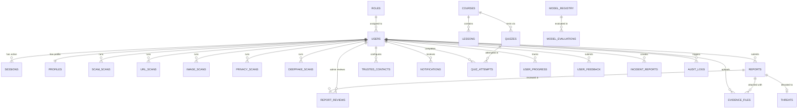

# SURAKSHA AI – Database Design & Schema Specification

## 1. Relational Database Overview
The **SURAKSHA AI** database schema is normalized to 3NF, utilizing foreign keys, cascading rules, and targeted compound indexes to guarantee fast lookups, data integrity, and strict auditability.

Supported Engines:
- **Development**: Local SQLite (`suraksha.db` with WAL mode & foreign key pragmas enabled) or Local PostgreSQL 15+.
- **Production**: PostgreSQL with connection pooling via SQLAlchemy 2.0.

---

## 2. Entity Relationship Diagram (ERD)

---

## 3. Core Table Specifications

### 3.1 Authentication & User Management
1. **`roles`**:
   - `id` (INTEGER, PK)
   - `name` (VARCHAR(50), UNIQUE) - `USER`, `ADMIN`, `COMMUNITY_MODERATOR`
   - `description` (VARCHAR(255))
   - `created_at` (TIMESTAMP)

2. **`users`**:
   - `id` (UUID, PK)
   - `email` (VARCHAR(255), UNIQUE, INDEXED)
   - `password_hash` (VARCHAR(255)) - Argon2id hash
   - `role_id` (INTEGER, FK -> roles.id)
   - `is_active` (BOOLEAN, DEFAULT TRUE)
   - `is_verified` (BOOLEAN, DEFAULT FALSE)
   - `created_at` (TIMESTAMP)
   - `updated_at` (TIMESTAMP)

3. **`profiles`**:
   - `id` (UUID, PK)
   - `user_id` (UUID, FK -> users.id, UNIQUE, ON DELETE CASCADE)
   - `full_name` (VARCHAR(150))
   - `phone_number` (VARCHAR(20), NULLABLE)
   - `preferred_language` (VARCHAR(10), DEFAULT 'en') - `en`, `kn`, `hi`
   - `senior_mode` (BOOLEAN, DEFAULT FALSE)
   - `avatar_url` (VARCHAR(255), NULLABLE)
   - `created_at` (TIMESTAMP)
   - `updated_at` (TIMESTAMP)

4. **`sessions`**:
   - `id` (UUID, PK)
   - `user_id` (UUID, FK -> users.id, ON DELETE CASCADE)
   - `token_hash` (VARCHAR(255), INDEXED)
   - `ip_address` (VARCHAR(45))
   - `user_agent` (VARCHAR(500))
   - `expires_at` (TIMESTAMP)
   - `created_at` (TIMESTAMP)

### 3.2 Cyber Threat Scanning & Forensic Logs
5. **`scam_scans`**:
   - `id` (UUID, PK)
   - `user_id` (UUID, FK -> users.id, NULLABLE) - Supports guest/auth scans
   - `content_snippet` (TEXT) - Truncated / sanitized input message
   - `risk_score` (INTEGER) - 0 to 100
   - `risk_level` (VARCHAR(20)) - `LOW`, `MEDIUM`, `HIGH`, `CRITICAL`
   - `scam_category` (VARCHAR(50)) - `BANK_KYC`, `UPI_FRAUD`, `LOTTERY`, `JOB_OFFER`, etc.
   - `indicators` (JSON) - Matched heuristic rules & ML tokens
   - `recommendations` (JSON) - Actionable advice list
   - `created_at` (TIMESTAMP)

6. **`url_scans`**:
   - `id` (UUID, PK)
   - `user_id` (UUID, FK -> users.id, NULLABLE)
   - `url` (VARCHAR(2048))
   - `domain` (VARCHAR(255), INDEXED)
   - `risk_score` (INTEGER) - 0 to 100
   - `risk_level` (VARCHAR(20))
   - `is_ip_host` (BOOLEAN)
   - `has_ssl` (BOOLEAN)
   - `lookalike_target` (VARCHAR(100), NULLABLE)
   - `redirect_chain` (JSON)
   - `analysis_details` (JSON)
   - `created_at` (TIMESTAMP)

7. **`image_scans`**:
   - `id` (UUID, PK)
   - `user_id` (UUID, FK -> users.id, NULLABLE)
   - `file_hash` (VARCHAR(64), INDEXED) - SHA-256
   - `file_name` (VARCHAR(255))
   - `extracted_text` (TEXT)
   - `risk_score` (INTEGER)
   - `risk_level` (VARCHAR(20))
   - `detected_entities` (JSON) - QR codes, UPI IDs, bank references
   - `created_at` (TIMESTAMP)

8. **`privacy_scans`**:
   - `id` (UUID, PK)
   - `user_id` (UUID, FK -> users.id, NULLABLE)
   - `redacted_preview` (TEXT)
   - `detected_types` (JSON) - Aadhaar, PAN, Phone, Email
   - `risk_score` (INTEGER)
   - `created_at` (TIMESTAMP)

9. **`deepfake_scans`**:
   - `id` (UUID, PK)
   - `user_id` (UUID, FK -> users.id, NULLABLE)
   - `media_type` (VARCHAR(20)) - `IMAGE`, `VIDEO`, `AUDIO`
   - `file_hash` (VARCHAR(64))
   - `authenticity_score` (INTEGER) - 0 to 100
   - `forensic_flags` (JSON) - Metadata anomalies, compression artifacts
   - `limitations_disclaimer` (TEXT)
   - `created_at` (TIMESTAMP)

### 3.3 Community Threat Intelligence & Verification Workflow
10. **`reports`**:
    - `id` (UUID, PK)
    - `report_code` (VARCHAR(30), UNIQUE, INDEXED) - e.g. `SUR-2026-XXXXX`
    - `user_id` (UUID, FK -> users.id, ON DELETE SET NULL)
    - `threat_type` (VARCHAR(50)) - `MESSAGE`, `PHONE`, `URL`, `SCREENSHOT`, `HARASSMENT`
    - `target_value` (VARCHAR(500)) - Phone number, URL, or sender handle
    - `description` (TEXT)
    - `region` (VARCHAR(100), NULLABLE)
    - `status` (VARCHAR(30), DEFAULT 'PENDING', INDEXED) - `PENDING`, `UNDER_REVIEW`, `VERIFIED`, `REJECTED`, `DUPLICATE`, `RESOLVED`
    - `is_public_alert` (BOOLEAN, DEFAULT FALSE)
    - `duplicate_of_id` (UUID, FK -> reports.id, NULLABLE)
    - `created_at` (TIMESTAMP)
    - `updated_at` (TIMESTAMP)

11. **`report_reviews`**:
    - `id` (UUID, PK)
    - `report_id` (UUID, FK -> reports.id, ON DELETE CASCADE)
    - `admin_id` (UUID, FK -> users.id)
    - `action_taken` (VARCHAR(50)) - `APPROVED_VERIFIED`, `REJECTED`, `MARKED_DUPLICATE`, `RESOLVED`
    - `internal_notes` (TEXT)
    - `public_notes` (TEXT, NULLABLE)
    - `created_at` (TIMESTAMP)

12. **`threats`**:
    - `id` (UUID, PK)
    - `origin_report_id` (UUID, FK -> reports.id, NULLABLE)
    - `indicator_type` (VARCHAR(30)) - `PHONE`, `URL`, `UPI_ID`, `SMS_SENDER`
    - `indicator_value` (VARCHAR(500), INDEXED)
    - `threat_level` (VARCHAR(20)) - `MEDIUM`, `HIGH`, `CRITICAL`
    - `description` (TEXT)
    - `verified_by_admin_id` (UUID, FK -> users.id)
    - `incident_count` (INTEGER, DEFAULT 1)
    - `is_active` (BOOLEAN, DEFAULT TRUE)
    - `created_at` (TIMESTAMP)
    - `updated_at` (TIMESTAMP)

### 3.4 Evidence Vault & Incident Reporting
13. **`evidence_files`**:
    - `id` (UUID, PK)
    - `user_id` (UUID, FK -> users.id, ON DELETE CASCADE)
    - `report_id` (UUID, FK -> reports.id, NULLABLE, ON DELETE SET NULL)
    - `file_code` (VARCHAR(30), UNIQUE, INDEXED) - e.g. `EVD-XXXXXX`
    - `original_name` (VARCHAR(255))
    - `stored_path` (VARCHAR(500))
    - `mime_type` (VARCHAR(100))
    - `file_size_bytes` (BIGINT)
    - `sha256_hash` (VARCHAR(64), INDEXED)
    - `incident_category` (VARCHAR(50))
    - `incident_date` (TIMESTAMP)
    - `description` (TEXT)
    - `created_at` (TIMESTAMP)

14. **`incident_reports`**:
    - `id` (UUID, PK)
    - `user_id` (UUID, FK -> users.id, ON DELETE CASCADE)
    - `incident_title` (VARCHAR(200))
    - `category` (VARCHAR(50))
    - `total_financial_loss` (NUMERIC(12,2), DEFAULT 0.00)
    - `timeline_summary` (TEXT)
    - `evidence_file_ids` (JSON) - Array of attached evidence UUIDs
    - `official_portal_guidance` (TEXT) - Instructions for cybercrime.gov.in / 1930
    - `created_at` (TIMESTAMP)

### 3.5 Specialized Safety, Learning & Notifications
15. **`trusted_contacts`**:
    - `id` (UUID, PK)
    - `user_id` (UUID, FK -> users.id, ON DELETE CASCADE)
    - `name` (VARCHAR(100))
    - `relationship` (VARCHAR(50))
    - `phone_number` (VARCHAR(20))
    - `email` (VARCHAR(255), NULLABLE)
    - `has_explicit_consent` (BOOLEAN, DEFAULT FALSE)
    - `notify_on_critical_scam` (BOOLEAN, DEFAULT FALSE)
    - `created_at` (TIMESTAMP)

16. **`courses`**:
    - `id` (UUID, PK)
    - `slug` (VARCHAR(100), UNIQUE)
    - `title` (VARCHAR(200))
    - `description` (TEXT)
    - `target_audience` (VARCHAR(50)) - `GENERAL`, `WOMEN`, `SENIORS`, `STUDENTS`
    - `language` (VARCHAR(10), DEFAULT 'en')
    - `created_at` (TIMESTAMP)

17. **`lessons`**:
    - `id` (UUID, PK)
    - `course_id` (UUID, FK -> courses.id, ON DELETE CASCADE)
    - `order_index` (INTEGER)
    - `title` (VARCHAR(200))
    - `content` (TEXT)
    - `created_at` (TIMESTAMP)

18. **`quizzes`**:
    - `id` (UUID, PK)
    - `course_id` (UUID, FK -> courses.id, ON DELETE CASCADE)
    - `title` (VARCHAR(200))
    - `questions_data` (JSON) - Questions, options, correct indices, explanations
    - `passing_score` (INTEGER, DEFAULT 70)

19. **`quiz_attempts`**:
    - `id` (UUID, PK)
    - `user_id` (UUID, FK -> users.id, ON DELETE CASCADE)
    - `quiz_id` (UUID, FK -> quizzes.id, ON DELETE CASCADE)
    - `score` (INTEGER)
    - `passed` (BOOLEAN)
    - `created_at` (TIMESTAMP)

20. **`user_progress`**:
    - `id` (UUID, PK)
    - `user_id` (UUID, FK -> users.id, ON DELETE CASCADE)
    - `course_id` (UUID, FK -> courses.id, ON DELETE CASCADE)
    - `completed_lessons` (JSON) - Array of lesson IDs
    - `is_completed` (BOOLEAN, DEFAULT FALSE)
    - `updated_at` (TIMESTAMP)

21. **`notifications`**:
    - `id` (UUID, PK)
    - `user_id` (UUID, FK -> users.id, ON DELETE CASCADE)
    - `title` (VARCHAR(200))
    - `message` (TEXT)
    - `category` (VARCHAR(50)) - `SECURITY_ALERT`, `REPORT_UPDATE`, `SYSTEM`
    - `is_read` (BOOLEAN, DEFAULT FALSE, INDEXED)
    - `action_url` (VARCHAR(255), NULLABLE)
    - `created_at` (TIMESTAMP)

### 3.6 Auditing, AI Registry & Feedback
22. **`audit_logs`**:
    - `id` (UUID, PK)
    - `user_id` (UUID, FK -> users.id, NULLABLE)
    - `action` (VARCHAR(100), INDEXED) - `ADMIN_LOGIN`, `REPORT_STATUS_CHANGE`, `EVIDENCE_DOWNLOAD`
    - `resource_type` (VARCHAR(50))
    - `resource_id` (VARCHAR(100))
    - `details` (JSON)
    - `ip_address` (VARCHAR(45))
    - `user_agent` (VARCHAR(500))
    - `created_at` (TIMESTAMP)

23. **`model_registry`**:
    - `id` (UUID, PK)
    - `model_name` (VARCHAR(100), UNIQUE)
    - `version` (VARCHAR(30))
    - `model_type` (VARCHAR(50)) - `SCIKIT_LEARN_TFIDF`, `HEURISTIC_RULESET`, `OLLAMA_LLM`
    - `is_active` (BOOLEAN, DEFAULT TRUE)
    - `parameters` (JSON)
    - `created_at` (TIMESTAMP)

24. **`model_evaluations`**:
    - `id` (UUID, PK)
    - `model_id` (UUID, FK -> model_registry.id, ON DELETE CASCADE)
    - `dataset_name` (VARCHAR(100))
    - `accuracy` (NUMERIC(5,4))
    - `precision_score` (NUMERIC(5,4))
    - `recall_score` (NUMERIC(5,4))
    - `f1_score` (NUMERIC(5,4))
    - `evaluation_notes` (TEXT)
    - `evaluated_at` (TIMESTAMP)

25. **`user_feedback`**:
    - `id` (UUID, PK)
    - `user_id` (UUID, FK -> users.id, NULLABLE)
    - `scan_type` (VARCHAR(50))
    - `scan_id` (UUID)
    - `rating` (INTEGER) - 1 to 5
    - `feedback_text` (TEXT)
    - `created_at` (TIMESTAMP)
