# SURAKSHA AI – AI-Powered Community Cyber Defense & Public Digital Safety Platform

[-brightgreen.svg)](backend/tests/)
[](https://python.org)
[](https://fastapi.tiangolo.com)
[](https://nextjs.org)
[](LICENSE)
[-orange.svg)](#strict-credit-friendly-architecture)
[](https://cybercrime.gov.in)

> **SURAKSHA AI** is an advanced, community-driven digital safety platform engineered to protect citizens (students, women, senior citizens, rural communities, and businesses) against online fraud, phishing, scams, cyber harassment, and digital threats.
>
> Built with a zero-cost local-first computing model, SURAKSHA AI delivers AI-powered scam analysis, tamper-evident evidence vaults, multilingual guidance (**English, Kannada, Hindi**), and SOC administrator workflows without requiring a single paid cloud API.

---

## Table of Contents
- [Executive Summary](#executive-summary)
- [Strict Credit-Friendly Architecture ($0 Budget)](#strict-credit-friendly-architecture-0-budget)
- [Core Modules Overview (All 13 Modules)](#core-modules-overview-all-13-modules)
- [System Architecture](#system-architecture)
- [Quickstart Installation Guide](#quickstart-installation-guide)
  - [Prerequisites](#prerequisites)
  - [Backend Setup (FastAPI)](#1-backend-setup-fastapi)
  - [Admin Provisioning CLI](#2-admin-account-provisioning)
  - [Frontend Setup (Next.js 14)](#3-frontend-setup-nextjs-14)
  - [Docker Compose Alternative](#4-docker-compose-deployment-optional)
- [Automated Testing & Verification](#automated-testing--verification)
- [Security Hardening & OWASP Compliance](#security-hardening--owasp-compliance)
- [Emergency Helplines & Statutory Guidance](#emergency-helplines--statutory-guidance)
- [Documentation Index](#documentation-index)

---

## Executive Summary

As digital payments and online communications expand across India, citizens face evolving cyber threats:
- **UPI & Payment Frauds**: Fake payment screenshots, collect-request traps, QR code scams.
- **Bank KYC & Utility Threats**: SMS extortion claiming bank account freeze or electricity disconnection tonight.
- **Phishing & Lookalike Domains**: Deceptive domains impersonating SBI, HDFC, ICICI, Income Tax, and Aadhaar portals.
- **Cyber Harassment & Sextortion**: Image manipulation, blackmail, physical cyberstalking, and defamation targeting women and youth.
- **Identity Theft**: Unredacted Aadhaar, PAN, phone, and payment card numbers exposed in documents.
- **Deepfake Media**: Synthetic AI portraits, cloned voices, and manipulated video receipts.

SURAKSHA AI solves these challenges through accessible on-device heuristic classifiers, transparent risk scoring, structured police FIR dossier packaging, and inclusive design tailored for non-technical citizens and senior citizens.

---

## Strict Credit-Friendly Architecture ($0 Budget)

SURAKSHA AI is built from the ground up for student developers, civic non-profits, and resource-conscious environments:
1. **Zero Paid Cloud Services**: No AWS, GCP, or Azure billable infrastructure. Runs locally on standard laptops or self-hosted servers.
2. **Zero Paid AI Tokens**: No OpenAI, Anthropic, or external metered API calls.
3. **Local Machine Learning**: Scikit-Learn TF-IDF + Multinomial Naive Bayes pipelines and OpenCV/Pillow image forensics running entirely on CPU.
4. **Local LLM with Graceful Fallback**: Optional integration with local Ollama (`llama3.2`, `phi3`), backed by an extensive offline rule-based dialogue tree in English, Kannada, and Hindi.
5. **Dual SQLite / PostgreSQL Engine**: Single-file SQLite (`suraksha.db`) for immediate zero-config setup, fully compatible with local PostgreSQL.
6. **In-Memory Rate Limiting**: Zero Redis requirement; thread-safe sliding-window limiter prevents abuse locally.

---

## Core Modules Overview (All 13 Modules)

| # | Module | Citizen & SOC Capabilities | Route |
|---|---|---|---|
| **1** | **AI Scam Message Detection** | Analyzes SMS, WhatsApp, and email messages using a hybrid TF-IDF + Naive Bayes classifier and 10 heuristic fraud indicators. Scores 0–100 with clear token highlights. | `/scam-detection` |
| **2** | **Intelligent Phishing URL Scanner** | Audits links with SSRF defenses (blocking loopback/private IPs/cloud metadata), Levenshtein homoglyph distance against 23+ Indian banks, and suspicious TLD audits. | `/url-scanner` |
| **3** | **Screenshot & Image Scam Detection** | Magic-byte image validation, Tesseract OCR wrapper + resilient Pillow fallback, and fake payment receipt / UTR detector with mandatory warning disclaimers. | `/screenshot-scanner` |
| **4** | **Multilingual AI Cyber Assistant** | Trilingual safety dialogue tree (English, Kannada ಕನ್ನಡ, Hindi हिन्दी) with real-time OTP/PIN credential privacy guardrails, Web Speech API audio, and 1930 integration. | `/assistant` |
| **5** | **Community Threat Intelligence** | Crowdsourced threat submission, automatic duplicate normalization, reference codes (`SUR-REP-XXXXXX`), admin review lifecycle, and privacy-preserved public alerts feed. | `/community-reports` |
| **6** | **Cybercrime Evidence Management** | Tamper-evident private vault (`storage/evidence/`), SHA-256 cryptographic hashing, UUID isolation, and structured FIR incident dossier compilation with official guidance. | `/evidence-vault` |
| **7** | **Personal Data & Privacy Protection** | In-memory zero-cloud PII detector validating Indian Aadhaar (Verhoeff $D_5$ checksum), PAN, Luhn cards, phone numbers, and UPI handles with instant side-by-side redaction. | `/privacy-protection` |
| **8** | **Deepfake Media Authenticity Forensics** | Error Level Analysis (ELA) for image tampering, EXIF metadata inspection detecting AI generative tools (Midjourney, Stable Diffusion, ComfyUI, Photoshop), and statutory limitation notices. | `/deepfake-analysis` |
| **9** | **Women Cyber Safety & Crisis Response** | Sextortion and stalking analyzer, IT Act 66E/67A evidence checklist, consented emergency contacts circle, and one-click WhatsApp/SMS SOS alert generator. | `/women-safety` |
| **10** | **Senior Citizen High-Accessibility Portal** | High-contrast large-font UI, Web Speech API trilingual text-to-speech audio read-aloud, zero-jargon explanations for pension/electricity scams, and direct 1930 dialing. | `/senior-protection` |
| **11** | **Cyber Awareness Academy** | 6 seeded courses, 12 interactive lessons, 6 quizzes with real-time scoring, completion progress tracking, and verifiable badges (UPI Shield, Phishing Detective, etc.). | `/cyber-awareness` |
| **12** | **Notification Center & Citizen Alerts** | In-app notification center, unread count badge, automated notifications when threat reports are reviewed, and high-priority admin broadcast warnings. | `/notifications` |
| **13** | **Admin Security & SOC Management** | Role-based access control with last-admin safeguard, report moderation queue, append-only security audit trail explorer, vault storage metrics, and indicator broadcaster. | `/admin/dashboard` |

---

## System Architecture

```mermaid
flowchart TD
    subgraph Frontend["Frontend (Next.js 14 App Router)"]
        UI_Citizen["Citizen Portal (/dashboard)"]
        UI_Admin["SOC Admin Command Center (/admin)"]
        UI_Public["Public Threat Alerts & Tracker"]
    end

    subgraph Defense["Defensive Middleware & API Gateway"]
        MW_Sec["OWASP Security Headers Middleware"]
        MW_Rate["In-Memory Sliding-Window Rate Limiter"]
        MW_CORS["CORS Policy Enforcement"]
    end

    subgraph Backend["FastAPI Asynchronous Engine"]
        API_Auth["Auth & Session (Argon2id + JWT)"]
        API_Scam["Scam Classifier (TF-IDF + Heuristics)"]
        API_URL["Phishing Scanner (SSRF Guard + Homoglyph)"]
        API_Image["Screenshot OCR & Receipt Validator"]
        API_Chat["Trilingual Assistant & OTP Guardrail"]
        API_Evidence["Evidence Vault & FIR Dossier Generator"]
        API_Privacy["In-Memory PII Redactor (Verhoeff/Luhn)"]
        API_Deepfake["Forensics Engine (ELA + EXIF Signature)"]
        API_Education["Cyber Awareness Academy & Quizzes"]
        API_Admin["SOC Management & Audit Explorer"]
    end

    subgraph Storage["Persistent Local Storage Layer"]
        DB[(Dual Engine: SQLite / PostgreSQL)]
        Vault[("Tamper-Evident Evidence Vault (storage/evidence/)")]
    end

    Frontend --> Defense
    Defense --> Backend
    Backend --> Storage
```



---

## Quickstart Installation Guide

### Prerequisites
- **Operating System**: Windows 10/11, Ubuntu 22.04+, or macOS
- **Python**: `3.10` to `3.13` (Tested and verified on Python 3.13.14)
- **Node.js**: `v18.0.0` or higher (Tested on Node.js v24.19.0 with npm 11.17.0)
- **Git**: For source version control

---

### 1. Backend Setup (FastAPI)

1. **Clone the repository**:
   ```bash
   git clone https://github.com/Bhimashankar2005/suraksha-ai.git
   cd suraksha-ai
   ```

2. **Create and activate a Python virtual environment**:
   ```bash
   # Windows PowerShell
   python -m venv venv
   .\venv\Scripts\Activate.ps1

   # Linux / macOS
   python3 -m venv venv
   source venv/bin/activate
   ```

3. **Install backend dependencies**:
   ```bash
   pip install -r backend/requirements.txt
   ```

4. **Initialize database & seed default data**:
   The database initializes automatically on first startup, creating all 25 tables and seeding standard courses, quizzes, and roles in `suraksha.db`.

5. **Start the backend development server**:
   ```bash
   python backend/run.py
   ```
   The backend API is now online at:
   - **Base API**: `http://localhost:8000`
   - **Interactive OpenAPI Documentation**: `http://localhost:8000/api/v1/docs`
   - **System Health Check**: `http://localhost:8000/api/v1/health`

---

### 2. Admin Account Provisioning

To access the SOC Admin Portal, provision your administrative credentials using the secure CLI provisioning script:

```bash
python backend/app/scripts/create_admin.py --email admin@suraksha.gov.in --password "AdminSecure2026!" --name "Chief SOC Administrator"
```

The script assigns the immutable `ADMIN` role, verifies password complexity, and logs the initialization event in the security audit trail.

---

### 3. Frontend Setup (Next.js 14)

1. **Navigate to the frontend directory**:
   ```bash
   cd frontend
   ```

2. **Install Node.js dependencies**:
   ```bash
   npm install
   ```

3. **Start the Next.js development server**:
   ```bash
   npm run dev
   ```
   The user interface is now accessible at:
   - **Citizen Safety Portal**: `http://localhost:3000`
   - **Citizen Login**: `http://localhost:3000/login`
   - **SOC Admin Command Center**: `http://localhost:3000/admin/login`

---

### 4. Docker Compose Deployment (Optional)

For containerized deployment with local PostgreSQL:
```bash
docker-compose up --build -d
```
Docker Compose spins up:
- `suraksha-backend` on port `8000`
- `suraksha-frontend` on port `3000`
- `suraksha-db` (PostgreSQL 16) on port `5432`

---

## Automated Testing & Verification

SURAKSHA AI includes a comprehensive automated test suite covering unit tests, heuristic validation, security audits, and full citizen-to-admin integration workflows.

To execute the test suite:
```bash
# Run all 17 test suites
python -m pytest backend/tests/ -v

# Run specific module test suites
python -m pytest backend/tests/test_e2e_integration.py -v
python -m pytest backend/tests/test_security_hardening.py -v
python -m pytest backend/tests/test_privacy.py -v
```

### Test Coverage Summary
- **Total Tests**: **152 passing tests (100% pass rate)**
- **Execution Time**: Under **5 seconds**
- **Suites**:
  - `test_health.py`: Database connectivity, seeded models, roles.
  - `test_auth.py`: Argon2id password hashing, JWT sessions, strict RBAC.
  - `test_scam.py`: 10 heuristic fraud rules, TF-IDF classifier metrics (Precision 0.83, Recall 1.00).
  - `test_url.py`: SSRF guards, RFC 1918 blocking, bank homoglyphs.
  - `test_image.py`: Magic bytes, OCR wrapper, fake UTR receipt detector.
  - `test_chat.py`: Trilingual guidance, OTP credential privacy guardrail.
  - `test_reports.py`: Duplicate detection, moderation queue, public feed.
  - `test_evidence.py`: SHA-256 evidence hashing, UUID storage, FIR dossier.
  - `test_privacy.py`: Verhoeff $D_5$ Aadhaar, PAN, Luhn cards, phone masking.
  - `test_demographics.py`: Women sextortion analysis, Senior TTS audio explainers.
  - `test_deepfake.py`: Image ELA metrics, generative tool signature audits.
  - `test_education.py`: Courses, lesson completion, quiz grading, badge awards.
  - `test_notifications.py`: Citizen notifications, broadcast alerts, read state.
  - `test_admin_management.py`: User directory, last-admin safeguard, audit explorer.
  - `test_dashboard.py`: Real database metric aggregations.
  - `test_e2e_integration.py`: Complete citizen-to-admin end-to-end lifecycle.
  - `test_security_hardening.py`: Rate limiting, OWASP headers, path traversal, SQLi.

---

## Security Hardening & OWASP Compliance

1. **Defensive Response Headers**:
   - `X-Content-Type-Options: nosniff`
   - `X-Frame-Options: DENY`
   - `X-XSS-Protection: 1; mode=block`
   - `Strict-Transport-Security: max-age=31536000; includeSubDomains`
   - `Referrer-Policy: strict-origin-when-cross-origin`
   - `Permissions-Policy: geolocation=(), camera=(), microphone=(self)`
   - `Content-Security-Policy: default-src 'self'; frame-ancestors 'none';`

2. **In-Memory Rate Limiting**:
   - Auth endpoints: Max 10 requests / 60 seconds per IP (credential brute-force defense).
   - Scanning APIs: Max 60 requests / 60 seconds per IP (abuse protection).
   - Returns standard HTTP `429 Too Many Requests` with `Retry-After` header and immediate helpline guidance.

3. **Input Sanitization & Storage Security**:
   - Strips null bytes (`\x00`) and unprintable control characters.
   - Filesystem path traversal defense (`validate_safe_path`) prevents `../` path breakouts on evidence downloads.
   - All SQL database queries use parameterized SQLAlchemy queries exclusively.

---

## Emergency Helplines & Statutory Guidance

> [!IMPORTANT]
> **STATUTORY POLICE REPORTING NOTICE**:
> SURAKSHA AI is an automated digital safety and forensic packaging platform. This platform does **NOT** itself register a formal Police First Information Report (FIR). To initiate formal criminal proceedings or bank fund freezes under Sections 43/66 of the Information Technology Act, citizens must immediately lodge their compiled incident dossier at the official National Cyber Crime Reporting Portal or call the national helpline.

| Agency / Service | Contact | Coverage | Description |
|---|---|---|---|
| **National Cyber Crime Helpline** | **1930** | Pan-India (24x7) | Immediate Golden Hour reporting to freeze stolen funds in bank accounts. |
| **National Emergency Number** | **112** | Pan-India (24x7) | Police, fire, and ambulance emergency assistance. |
| **Women Helpline** | **1091** | Pan-India (24x7) | Dedicated crisis support for women facing harassment or violence. |
| **National Commission for Women (NCW)** | **7827170170** | Pan-India (24x7) | Cyber complaint helpline for women facing sextortion, doxxing, or abuse. |
| **National Cyber Crime Portal** | [cybercrime.gov.in](https://cybercrime.gov.in) | Online Portal | Official Ministry of Home Affairs (MHA) reporting portal for formal complaints. |
| **RBI Sachet Portal** | [sachet.rbi.org.in](https://sachet.rbi.org.in) / **14440** | Pan-India | Reserve Bank of India portal to verify and report illegal lending apps & deposits. |
| **DoT Sanchar Saathi** | [sancharsaathi.gov.in](https://sancharsaathi.gov.in) / **1947** | Pan-India | Department of Telecommunications portal to block lost SIMs and verify mobile numbers. |

---

## Documentation Index

- **Citizen User Guide**: [USER_GUIDE.md](USER_GUIDE.md) — Comprehensive manual covering all 11 citizen modules, fraud spotting tips, and dossier generation.
- **SOC Administrator Manual**: [ADMIN_GUIDE.md](ADMIN_GUIDE.md) — Guide for SOC analysts, moderation queues, audit trail inspection, and broadcast alerts.
- **System Architecture**: [ARCHITECTURE.md](ARCHITECTURE.md) — Technical blueprint, component topologies, and data flows.
- **Database Design**: [DATABASE_DESIGN.md](DATABASE_DESIGN.md) — 25-table 3NF relational schema and index specifications.
- **Development Roadmap & Progress**: [DEVELOPMENT_PROGRESS.md](DEVELOPMENT_PROGRESS.md) — Live changelog and phase-by-phase implementation record.
