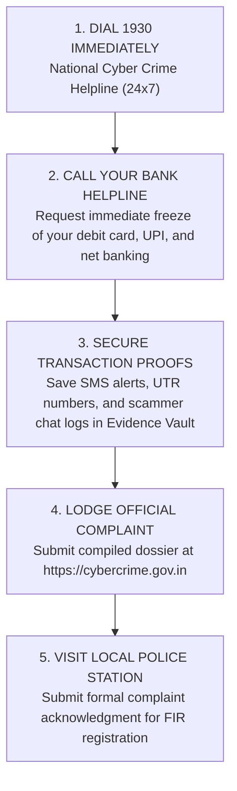

# SURAKSHA AI – Citizen User Guide & Digital Safety Handbook

Welcome to **SURAKSHA AI**, India's community-driven cyber defense and public digital safety platform. This handbook provides step-by-step guidance on how to protect yourself, your family, and your community from online fraud, scams, phishing, and digital harassment.

---

## Table of Contents
1. [Core Principles & $0 Budget Privacy Model](#1-core-principles--privacy-model)
2. [Getting Started: Registration & Dashboard](#2-getting-started)
3. [Module 1: AI Scam Message Detection](#3-module-1-ai-scam-message-detection)
4. [Module 2: Intelligent Phishing URL Scanner](#4-module-2-intelligent-phishing-url-scanner)
5. [Module 3: Screenshot & Fake Receipt Scanner](#5-module-3-screenshot--fake-receipt-scanner)
6. [Module 4: Multilingual AI Cyber Assistant](#6-module-4-multilingual-ai-cyber-assistant)
7. [Module 5: Community Threat Intelligence & Reporting](#7-module-5-community-threat-intelligence--reporting)
8. [Module 6: Cybercrime Evidence Vault & FIR Dossiers](#8-module-6-cybercrime-evidence-vault--fir-dossiers)
9. [Module 7: Personal Data & Privacy Protection](#9-module-7-personal-data--privacy-protection)
10. [Module 8: Deepfake Media Authenticity Forensics](#10-module-8-deepfake-media-authenticity-forensics)
11. [Module 9: Women Cyber Safety & Crisis Response](#11-module-9-women-cyber-safety--crisis-response)
12. [Module 10: Senior Citizen High-Accessibility Portal](#12-module-10-senior-citizen-high-accessibility-portal)
13. [Module 11: Cyber Awareness Academy & Badges](#13-module-11-cyber-awareness-academy--badges)
14. [Module 12: Notification Center](#14-module-12-notification-center)
15. [Emergency Protocol: The Financial Fraud Golden Hour](#15-emergency-protocol-the-financial-fraud-golden-hour)

---

## 1. Core Principles & Privacy Model

- **100% Free & Open Source**: No subscriptions, no hidden charges, and zero paid cloud APIs.
- **Privacy-First (Zero Cloud Leakage)**: Your texts, passwords, Aadhaar numbers, and evidence are processed locally on your device and server. We never send your personal data to third-party commercial AI providers.
- **Trilingual Inclusivity**: Accessible in **English**, **Kannada (ಕನ್ನಡ)**, and **Hindi (हिन्दी)**.
- **Statutory Helpline Integration**: Every tool is linked to official Indian cyber helplines: **1930** (Cyber Fraud), **112** (Emergency), **1091** (Women Helpline), and **cybercrime.gov.in**.

---

## 2. Getting Started

### Creating an Account
1. Visit the portal at `http://localhost:3000`.
2. Click **Create Free Account** or navigate to `/register`.
3. Provide your Full Name, Email Address, and a strong password (minimum 8 characters).
4. Select your preferred language: English, Kannada, or Hindi.
5. If setting up for an elderly family member, toggle **Senior Citizen Mode** to enable high-contrast, large-font views by default.

### Navigating the Citizen Dashboard (`/dashboard`)
Once logged in, the Citizen Dashboard provides:
- **Emergency Action Card**: Instant one-click phone dialer for Cyber Crime Helpline **1930** and emergency advice.
- **Platform Telemetry**: Real-time counter of community threats analyzed, evidence files secured, and academy badges earned.
- **Quick-Scan Launcher**: Instant access to message, URL, screenshot, and privacy scanners.
- **Unread Notification Bell**: Alerts you immediately when an admin reviews your reported threat.

---

## 3. Module 1: AI Scam Message Detection (`/scam-detection`)

Use this tool whenever you receive a suspicious SMS, WhatsApp message, Telegram job offer, or email.

### How to Analyze a Message
1. Open `/scam-detection`.
2. Paste the raw text into the input field (or click one of the preset scenario chips: *Bank KYC Freeze*, *Electricity Cutoff*, *Part-time Job*, *Lottery*).
3. Click **Analyze Message Safety**.

### Understanding Your Results
- **Risk Score (0–100)**:
  - `0–30 (LOW)`: Transactional or legitimate pattern.
  - `31–60 (MEDIUM)`: Caution advised; shares characteristics with unsolicited marketing.
  - `61–85 (HIGH)`: High probability of phishing, fake urgency, or banking fraud.
  - `86–100 (CRITICAL)`: Dangerous fraud attempt (e.g., impersonation, OTP extortion, digital arrest).
- **Trigger Factor Badges**: Highlights specific triggers detected in the text (e.g., `Urgency Pressure`, `Threat of Disconnection`, `Unofficial Shortlink`).
- **Escalation to Community**: If verified as fraud, click **Escalate as Threat Report** to submit the scam to the community verification queue with one click.

---

## 4. Module 2: Intelligent Phishing URL Scanner (`/url-scanner`)

Never click unknown links in messages. Run them through the Phishing Scanner first.

### How to Inspect a Link
1. Copy the suspicious web address (e.g., `http://sbi-kyc-update.xyz/login.php`).
2. Paste it into `/url-scanner` and click **Audit Website Safety**.

### Technical Diagnostics Provided
- **SSRF Defense**: Automatically blocks malicious internal addresses trying to probe your private home network.
- **Lookalike Domain Warning**: Detects brand mimicry against 23+ authentic Indian banks and portals (e.g., warns if a site is pretending to be `onlinesbi.sbi` or `incometax.gov.in`).
- **Suspicious TLD Alert**: Flags high-risk domain extensions frequently abused by fraudsters (`.xyz`, `.top`, `.live`, `.apk`).
- **Shortlink Revealer**: Detects URL masking from services like `bit.ly` or `tinyurl`.

---

## 5. Module 3: Screenshot & Fake Receipt Scanner (`/screenshot-scanner`)

Fraudsters frequently use spoofing apps (like fake Paytm/PhonePe screens) to claim they sent you money.

### The Golden Safety Rule
> [!WARNING]
> **A payment screenshot NEVER proves money was received.** Fraudulent apps can generate identical "Payment Successful" screens with fake UTR reference numbers and green checkmarks. **Always check your official bank balance directly in your banking app or via official bank SMS.**

### How to Scan a Screenshot
1. Take a screenshot of the payment receipt or transaction screen.
2. Upload the image file (PNG, JPG, or WEBP) into `/screenshot-scanner`.
3. The on-device OCR engine extracts text and checks for:
   - Payment confirmation mimicry.
   - 12-digit UTR reference validation.
   - Transaction amounts.
4. The scanner flags synthetic receipts and displays step-by-step verification advice.

---

## 6. Module 4: Multilingual AI Cyber Assistant (`/assistant`)

A 24x7 cyber safety advisor providing natural conversational guidance in your own language.

### Supported Languages & Voice Features
- **Languages**: English, Kannada (ಕನ್ನಡ), and Hindi (हिन्दी). Switch languages at any time using the header toggle.
- **Voice Input (Speech-to-Text)**: Click the microphone icon to speak your query.
- **Voice Read-Aloud (Text-to-Speech)**: Click the speaker icon on any assistant response to hear the advice spoken aloud in your chosen language.

### Built-in Privacy Guardrail
If you inadvertently paste sensitive credentials (such as an OTP, ATM PIN, UPI PIN, or bank password), SURAKSHA AI immediately intercepts the message, displays a **CRITICAL PRIVACY ALERT**, and instructs you never to share the code with anyone over phone, chat, or email.

---

## 7. Module 5: Community Threat Intelligence & Reporting (`/community-reports`)

Help protect fellow citizens by reporting scam phone numbers, phishing URLs, and SMS headers.

### Submitting a Threat
1. Navigate to `/community-reports` and select the **Submit Report** tab.
2. Choose threat type: `PHONE`, `URL`, `MESSAGE`, or `HARASSMENT`.
3. Enter the offending value (e.g., `+91 9822334455` or `sbi-kyc.top`).
4. Add a brief description of what the fraudster claimed.
5. Choose whether to report anonymously or under your verified account.
6. Submit to receive your unique tracking reference: **`SUR-REP-XXXXXX`**.

### Tracking Report Status
- Enter your report code into the **Track Status** tab to monitor the moderation lifecycle:
  `PENDING` ➔ `UNDER_REVIEW` ➔ `VERIFIED` (Published as public warning) / `RESOLVED`.
- All verified indicators appear in the **Verified Public Alerts Feed** with submitter identities completely redacted.

---

## 8. Module 6: Cybercrime Evidence Vault & FIR Dossiers (`/evidence-vault`)

Legal proceedings require tamper-evident digital evidence. The Evidence Vault secures files with cryptographic hashes for submission to police or `cybercrime.gov.in`.

### Securing Evidence
1. Open `/evidence-vault`.
2. Drag and drop evidence files (screenshots, chat transcripts `.txt`, bank statements `.pdf`).
3. Select the incident category (`UPI_FRAUD`, `FAKE_BANK`, `BLACKMAIL`, `DIGITAL_ARREST`).
4. Click **Secure in Vault**.
5. The platform validates magic-bytes, computes an immutable **SHA-256 cryptographic hash**, and stores the file in an isolated private directory.

### Compiling a Police Incident Dossier
1. Navigate to the **Incident Dossier Compiler** tab in `/evidence-vault`.
2. Fill in the incident title, estimated financial loss in INR, and a chronological timeline of events.
3. Select which secured evidence files belong to this incident.
4. Click **Compile Incident Dossier**.
5. The platform generates a structured report with tamper-evident hashes, ready to be printed or attached directly to your official complaint on `cybercrime.gov.in`.

---

## 9. Module 7: Personal Data & Privacy Protection (`/privacy-protection`)

Before sharing documents online or via email, mask your sensitive identifiers.

### Features & Indian Identifiers Redacted
- **Aadhaar Numbers**: Validates 12-digit numbers using the official Verhoeff $D_5$ checksum algorithm and masks to `XXXXXXXX1234` or `XXXX-XXXX-1234`.
- **PAN Cards**: Validates 10-character Indian PAN format and masks to `XXXXX1234X`.
- **Payment Cards**: Validates Visa, Mastercard, and RuPay card numbers via Luhn checksum and masks to `XXXX-XXXX-XXXX-1234`.
- **Mobile Numbers**: Masks Indian 10-digit numbers to `+91 XXXXX 12345`.
- **UPI VPAs**: Masks handles to `u***r@bank`.

### Pure In-Memory Processing
Text is sanitized entirely in memory and never written to external cloud logs. Click **Copy Sanitized Text** or **Download Clean File** to share securely.

---

## 10. Module 8: Deepfake Media Authenticity Forensics (`/deepfake-analysis`)

Examine suspect images, audio clips, and videos for signs of generative AI manipulation or digital tampering.

### Forensic Checks Performed
- **Error Level Analysis (ELA)**: Re-compresses image blocks to highlight localized compression anomalies indicative of spliced faces or edited text.
- **Generative AI Metadata Signatures**: Inspects EXIF data and container atoms for fingerprints left by tools such as Midjourney, Stable Diffusion, DALL-E, ComfyUI, ElevenLabs, and Photoshop.
- **Forensic Confidence Breakdown**: Displays an authenticity score (0–100%) and categorizes media as `LIKELY_AUTHENTIC`, `SUSPICIOUS_ANOMALIES_DETECTED`, or `PROBABLE_SYNTHETIC_OR_MANIPULATED`.
- *Statutory Note*: Media forensics provides probabilistic indicators to guide caution, not definitive legal proof.

---

## 11. Module 9: Women Cyber Safety & Crisis Response (`/women-safety`)

A specialized, trauma-informed crisis portal for women facing online stalking, sextortion, impersonation, or blackmail.

### Safety Protocols & Evidence Checklist
- **Threat Assessment**: Paste threatening messages or extortion demands to classify threat severity (`LOW`, `MEDIUM`, `HIGH`, `CRITICAL_EMERGENCY`).
- **Immediate Evidence Preservation**: Step-by-step instructions on capturing screenshots before perpetrators delete chat threads, preserving message headers, and logging timestamps under **Sections 66E and 67A of the IT Act**.
- **Trusted Contacts SOS**: Register trusted emergency contacts (with explicit consent). In a crisis, generate a pre-drafted SOS message and one-click WhatsApp dispatch link with emergency helplines.
- **Direct Crisis Helplines**: Instant dialing for Women Helpline **1091**, National Emergency **112**, NCW Cyber Cell **7827170170**, and **cybercrime.gov.in**.

---

## 12. Module 10: Senior Citizen High-Accessibility Portal (`/senior-protection`)

Tailored for elderly citizens and rural internet adopters who need high readability and audio assistance.

### Key Accessibility Features
- **Senior Mode Active by Default**: High-contrast dark backgrounds, enlarged readable typography (18px+), and simplified navigation.
- **Trilingual Audio Read-Aloud**: Every explanation includes a single-click speaker button that reads the safety advice in clear, natural speech in **English**, **Kannada**, or **Hindi**.
- **Zero-Jargon Explainers**:
  - *Pension Scam Explainer*: Plain language guide on why pensions never stop without a physical visit to the treasury or official Jeevan Pramaan app.
  - *Electricity Bill Explainer*: Explains why utility companies never send personal mobile numbers threatening power cutoffs at night.
  - *Digital Arrest Explainer*: Explains that police, CBI, and RBI never conduct trials or demand bail money over WhatsApp video calls.
- **Direct 1930 Cyber Police Card**: Single tap to place an emergency call to the national helpline.

---

## 13. Module 11: Cyber Awareness Academy & Badges (`/cyber-awareness`)

Learn practical defense techniques and earn verifiable safety badges.

### Available Courses
1. **UPI & Digital Payment Protection**: Spotting collect requests, QR fraud, and fake receipts.
2. **Spotting Phishing & Bank Suspension Links**: Identifying lookalike domains and fake KYC forms.
3. **Women Cyber Safety & Privacy**: Defending against sextortion, doxxing, and cyberstalking.
4. **Senior Citizen Digital Defense**: Recognizing pension tricks, electricity scams, and digital arrest threats.
5. **Passwords, 2FA & Account Hardening**: Building unhackable passwords and multi-factor authentication.
6. **Deepfakes & Synthetic Media**: Spotting manipulated images and cloned voices.

### Earning Badges
Read the bite-sized lessons, complete the interactive quizzes, and score 70% or higher to unlock safety badges (e.g., *UPI Fraud Shield*, *Phishing Detective*, *Cyber Defender*) displayed on your profile.

---

## 14. Module 12: Notification Center (`/notifications`)

Stay updated on your cyber safety status:
- **Report Status Updates**: Automatically notified when an administrator verifies or updates a threat you reported.
- **Priority Broadcast Alerts**: High-severity advisories broadcast by SOC administrators regarding widespread emerging scams.
- **Management**: Mark notifications as read, filter unread items, or clear completed notices.

---

## 15. Emergency Protocol: The Financial Fraud Golden Hour

If money has been fraudulently debited from your bank account or UPI wallet, **act immediately within the Golden Hour (first 60 minutes)**:

### Critical Checklist:
- **Do not delete chat messages** with the scammer; save them to your Evidence Vault first.
- Note the scammer's **phone number**, **UPI ID**, or **phishing URL**.
- Note the **12-digit UTR number** from your official bank debit SMS.
- Remember: **Bank and police officers will NEVER ask you for an OTP or PIN to reverse a transaction.**

